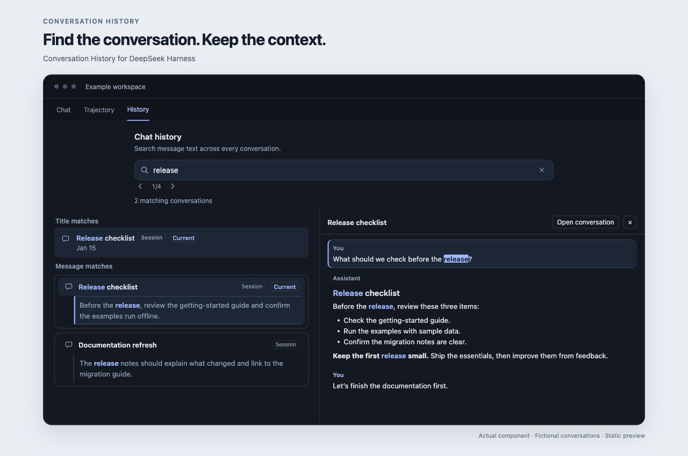
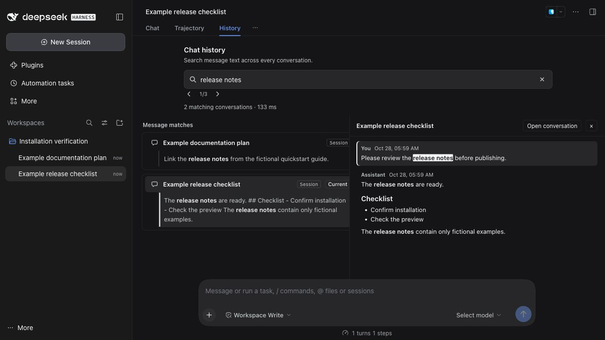

# Conversation History

A **History** tab for DeepSeek Harness. Find something you discussed earlier and read its context without leaving the current view.

[中文](README.md) · [Installation](#installation) · [Installation verification](#installation-verification) · [How-it-works](#how-it-works) · [Development](#development)



*Rendered from the actual plugin component. Every conversation, title and message shown is fictional.*

## Features

- Search across conversations, with separate title and message matches.
- Read surrounding messages in a side pane, then open the original conversation when needed.
- Highlight phrases and move between occurrences.
- Reuse local dialogue caches instead of parsing unchanged logs for every query.
- Show progress during the initial build and update results automatically.
- Follow the Harness language setting: English or Simplified Chinese.

Search includes user and assistant text. It excludes tool output, injected messages, fenced code and subagent conversations. Matching is literal, case-insensitive and flexible about whitespace between words; it is not semantic search.

## Installation

In DeepSeek Harness, open **Plugins**, click the arrow beside **Add plugin**, and choose **Install a third-party plugin**. Paste the following address and click **Install**:

```text
github:michaelfeng/dsh-conversation-history#v1.1.0
```

After installation, click **Enable now**. Open the plugin details and confirm that both the bundle and its **Conversation History component** are enabled and the component shows **Running**. Open a conversation that already has messages and select **History**; the blank new-session welcome screen does not show conversation tabs.

For a local checkout:

```sh
git clone https://github.com/michaelfeng/dsh-conversation-history.git
cd dsh-conversation-history
```

Enter the checkout’s absolute directory path in the same third-party installation dialog. Alternatively, use the Harness plugin-management tool's `install_bundle` action with the checkout's absolute path as `target`.

This is an independent third-party plugin, not an official DeepSeek project. Integration was checked against the desktop plugin interfaces in Harness **0.2.1-rc.3**. Other versions may require changes. The plugin depends on Harness session, connection and UI services; it is not a standalone web app.

If you previously installed an `@local/dsh-conversation-history` development copy, disable or remove it before installing this package to avoid duplicate component registration.

## Usage

Enter at least two characters, such as `release notes`. Select a message excerpt to preview its context, or select a title match to see recent messages. Use the previous/next controls to move between phrase occurrences, and **Open conversation** to return to the full conversation.

Each matching conversation contributes its latest matching message. Results are sorted by that message's timestamp. Responses include up to 100 conversations and indicate truncation. Regular expressions and fuzzy matching are not supported.

## Installation verification

Verified on 2026-10-28 using the Web instance bundled with the DeepSeek Harness **0.2.1-rc.3** desktop distribution on macOS. The instance used a separate temporary `DSH_HOME`; **v1.1.0** was installed from GitHub through the Plugins UI, with no model API key configured.



*This screenshot was captured after an actual installation. The workspace name, conversation titles and all messages are fictional test data; no personal chat history or credentials are included. The displayed latency is from this small test query, not a performance benchmark.*

| Check | Observed result |
|---|---|
| GitHub installation | The README's `github:...#v1.1.0` specification installed successfully; installed runtime files matched the published source |
| Activation | Bundle and component enabled, component reported Running, and History appeared in a conversation with messages |
| Restart | The plugin loaded after restarting the temporary Harness instance |
| Cross-conversation search | Searching `release notes` returned message matches from two fictional conversations |
| Context preview | Selecting an excerpt displayed user and assistant messages, Markdown headings and lists |
| Match navigation | Matching phrases were highlighted; Next match advanced the counter from `1/3` to `2/3` |
| Open conversation | The preview opened the intended conversation with the matching title |

These results cover the version and isolated Web environment above. Other Harness versions and deployment modes were not covered by this installation check.

## How it works

When the component starts, it begins reading sessions through the public Harness persistence API and saving a disposable projection of dialogue text. Later searches reconcile source revisions and reuse those projections.

Unchanged sessions reuse memory or disk caches. Live sessions project new events incrementally. Changed persisted sessions may require a full read, depending on the storage backend. Concurrent searches share indexing work, and progress polls consume a completed build instead of starting it again. Search and context loading have independent settling deadlines.

Large histories take longer to index initially. Query latency depends on corpus size, text volume and storage; no fixed millisecond performance is promised. The plugin does not require or change the host's global full-text index configuration.

### Local data

The plugin makes no external network requests, calls no model, requires no additional API key and includes no telemetry. The UI communicates with its backend over the Harness connection channel; remote deployments inherit the host's connection and storage boundaries.

Derived caches live under `$DSH_HOME/cache/conversation-history/` and contain conversation text. They are not encrypted: protect them like the original history. Original session logs are never modified. To rebuild, turn the component off, remove its derived cache, then turn it back on.

## Development

Node.js 22 or newer is required for local checks. No additional npm dependencies are needed.

```sh
npm test
npm run check:release
```

Tests use fictional fixtures and cover cache reuse, changed/deleted sessions, concurrency, progress polling, timeouts, long messages, highlighting and UI rendering.

To render the static previews used for the screenshots at the top of the READMEs:

```sh
npm run demo
```

Open the loopback URL printed in the terminal. This renders the real component with fixed sample data and never reads local Harness settings or conversation history. It is a screenshot/layout fixture, not an interactive Harness installation.

| File | Purpose |
|---|---|
| `index.js` | Search/context endpoints and plugin lifecycle |
| `dialogue-index.js` | Source reconciliation, dialogue projection and caching |
| `dialogue.js` | Text extraction, phrase matching and snippets |
| `client.js` | History UI and language dictionaries |
| `cordis.patch.yml` | Component registration and cache location |
| `tests/` | Synthetic regression fixtures |
| `scripts/` | Demo rendering and release-content checks |

For bug reports, include the Harness/plugin versions, reproduction steps and a minimal sanitized error in an [issue](https://github.com/michaelfeng/dsh-conversation-history/issues). Do not attach raw conversations, account settings or credentials.

## License

[MIT](LICENSE)
