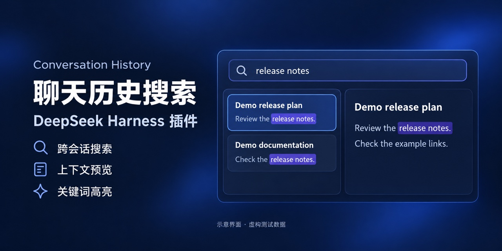

# Conversation History

给 DeepSeek Harness 加一个 **History / 历史** 标签页。搜到以前聊过的内容，直接在旁边读上下文。

[English](README.en.md) · [安装](#安装) · [安装验证](#安装验证) · [工作方式](#工作方式) · [开发](#开发)



*封面为功能示意图，使用虚构测试数据。真实安装截图见下方「安装验证」。*

## 能做什么

- **跨会话搜索**：输入关键词或短语，分别查看标题命中和消息命中。
- **在原位读上下文**：点击消息结果，在右侧查看前后对话，不必来回切换会话。
- **定位关键词**：高亮匹配内容，支持上一个 / 下一个匹配和打开原会话。
- **复用本地缓存**：未变化的记录不重复解析；首次整理时显示进度，结果自动更新。
- **中英文界面**：跟随 Harness 的语言设置。

搜索只处理用户与助手的对话文本，排除工具输出、注入消息、围栏代码块和子代理会话。支持不区分大小写的字面短语匹配，词语之间的空白可变化；它不是语义搜索。

## 安装

在 DeepSeek Harness 中打开 **Plugins / 插件**，点击 **Add plugin / 添加插件** 右侧的下拉箭头，选择 **Install a third-party plugin / 安装第三方插件**，粘贴下面的地址并点击 **Install / 安装**：

```text
github:michaelfeng/dsh-conversation-history#v1.1.0
```

安装完成后点击 **Enable now / 立即启用**。在插件详情中确认插件和 **Conversation History 组件** 两个开关都已开启，组件显示 **Running / 运行中**。进入一个已有消息的会话，即可看到 **History / 历史** 标签页；空白的新会话欢迎页不会显示会话标签。

如果需要使用本地源码：

```sh
git clone https://github.com/michaelfeng/dsh-conversation-history.git
cd dsh-conversation-history
```

然后在同一个“安装第三方插件”对话框中填写克隆后文件夹的绝对路径。也可以通过 Harness 的插件管理工具调用 `install_bundle`，把 `target` 设置为这个目录的绝对路径。

本项目是第三方插件，与 DeepSeek 官方无隶属关系。集成验证基于 Harness **0.2.1-rc.3** 的桌面插件接口；其他版本可能需要适配。插件运行需要 Harness 提供的会话、连接和界面服务，不能作为普通网页直接使用。

> 如果以前装过名称为 `@local/dsh-conversation-history` 的开发副本，请先关闭或移除旧副本，再安装本仓库版本，避免重复注册组件。

## 使用

1. 进入任意会话的 **History / 历史** 页面。
2. 输入至少两个字符，例如“发布”或 `release notes`。
3. 点击消息摘要，查看右侧上下文；点击标题命中，查看该会话的近期消息。
4. 用匹配导航按钮跳转关键词，需要继续聊天时点击 **打开会话**。

每个会话返回最近一条匹配消息，结果按这条消息的时间排序。一次最多返回 100 个会话，超过时会提示。短语搜索不支持正则表达式或模糊匹配。

## 安装验证

2026-10-28 在 macOS 上，使用 DeepSeek Harness **0.2.1-rc.3** 桌面发行版附带的 Web 实例完成验证。实例使用独立的临时 `DSH_HOME`，通过插件页面从 GitHub 安装 **v1.1.0**，未配置模型 API key。


*这是实际安装后的界面截图。工作区名称、会话标题和全部消息均为虚构测试数据，不包含个人聊天记录或密钥。图中耗时仅对应这次小样本查询，不代表性能基准。*

| 验证项目 | 实际结果 |
|---|---|
| GitHub 安装 | 使用 README 中的 `github:...#v1.1.0` 地址安装成功，安装文件与发布源码一致 |
| 插件启用 | bundle 和组件均启用，组件显示 Running，已有消息的会话中出现 History 标签 |
| 重启加载 | 重启临时 Harness 实例后插件仍正常加载 |
| 跨会话搜索 | 搜索 `release notes`，返回两段虚构会话中的消息命中 |
| 上下文预览 | 点击消息摘要后显示用户与助手消息、Markdown 标题和列表 |
| 关键词导航 | 高亮匹配短语，点击下一处匹配后计数从 `1/3` 变为 `2/3` |
| 打开原会话 | 从预览跳回对应会话，标题与目标一致 |

这些结果对应上述版本和隔离 Web 环境；其他 Harness 版本或部署方式尚未通过本次安装验证。

## 工作方式

组件启动时，插件通过 Harness 的会话存储接口提取对话文本，生成可重建的本地缓存。之后搜索先核对会话版本，再匹配已整理的文本。

- 未变化的会话直接复用内存或磁盘缓存。
- 活跃会话只整理新增事件。
- 已保存的会话发生变化时，可能需要重新读取该会话；具体成本取决于存储后端。
- 并发搜索共用正在进行的整理任务，进度轮询不会反复重启同一项工作。
- 搜索和上下文加载有独立超时处理，避免一直停留在等待状态。

首次整理大量历史记录会更慢。查询速度取决于会话数量、文本量和磁盘性能，本项目不承诺固定毫秒数。插件不需要启用 Harness 的全局全文索引，也不会改动它的配置。

### 本地数据

插件本身不发送外部网络请求，不调用模型，不需要额外的 API key，也不包含遥测。界面通过 Harness 的连接通道与插件后端通信；远程部署时应以 Harness 自身的连接和存储边界为准。

缓存默认保存在 `$DSH_HOME/cache/conversation-history/`，包含从聊天记录提取的文本。它不是加密存储，请按原始聊天记录同样的敏感程度保管。插件不会修改原始会话日志。关闭组件后可删除派生缓存，下次开启会重新建立。

## 开发

本地测试需要 Node.js 22 或更新版本，无需安装额外 npm 依赖：

```sh
npm test
npm run check:release
```

测试使用虚构数据，覆盖索引复用、会话更新与删除、并发请求、进度轮询、超时、长消息定位、关键词高亮和界面渲染。

生成使用虚构数据的插件界面静态预览：

```sh
npm run demo
```

访问终端给出的本机地址。预览直接渲染 `client.js` 中的界面组件，采用固定示例数据，不读取本机的 Harness 配置或聊天记录；它用于截图和布局检查，不是可交互的完整 Harness。

| 文件 | 用途 |
|---|---|
| `index.js` | 搜索、上下文接口和插件生命周期 |
| `dialogue-index.js` | 会话版本核对、文本整理和缓存 |
| `dialogue.js` | 对话提取、短语匹配和摘要 |
| `client.js` | History 界面与中英文文案 |
| `cordis.patch.yml` | 组件注册与缓存路径 |
| `tests/` | 虚构数据回归测试 |
| `scripts/` | 演示页生成和发布内容检查 |

遇到问题请提交 [Issue](https://github.com/michaelfeng/dsh-conversation-history/issues)，说明 Harness 版本、插件版本、复现步骤，以及经过删减的错误信息。请不要上传原始会话、账户配置或密钥。

## 许可证

[MIT](LICENSE)
